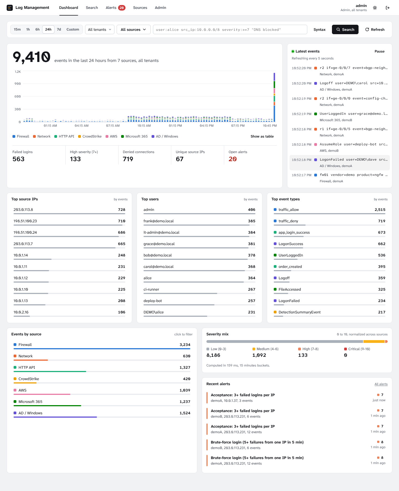
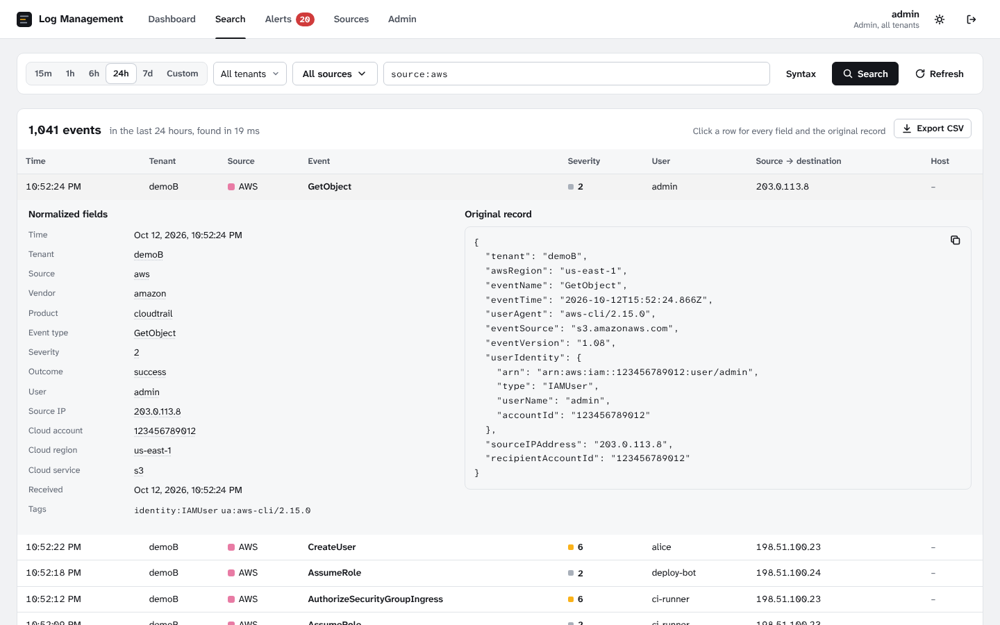
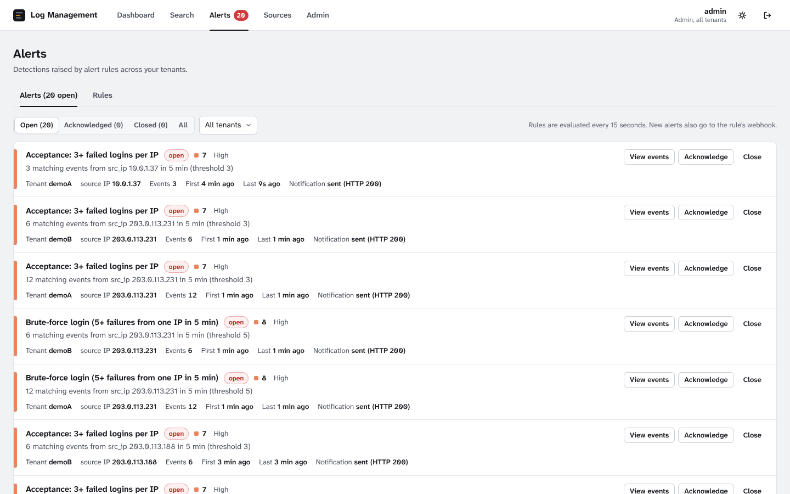

# Log Management

A multi-tenant log management system. It collects events from firewalls, routers, applications,
CrowdStrike, AWS CloudTrail, Microsoft 365 and Windows/AD, normalizes them into one schema, and
offers search, a dashboard and alerting over HTTPS. It runs as a **single-machine appliance**
(Docker Compose) or as a **SaaS deployment** on any cloud VM with a Let's Encrypt certificate.



| Part | Technology |
|---|---|
| Collectors | Node.js + TypeScript (syslog UDP/TCP, HTTP, files) |
| API | Fastify, JWT, zod |
| Storage | PostgreSQL 16, partitioned per tenant and per day, with row-level security |
| UI | React 19 + Recharts |
| Edge | Caddy (HTTPS) |
| Tests and CI | Vitest, GitHub Actions |

## Assignment coverage

| Requirement | Where / how |
|---|---|
| ≥4 real sources | Syslog **UDP 514** and **TCP 514** (RFC 3164/5424, CEF, key=value), **HTTP** `POST /api/ingest` (JSON, NDJSON, text), **file upload** and an **inbox folder**, and a **simulator** for all 7 sources |
| Normalization | One schema for all sources (`packages/core/src/normalizers`). Accepts the assignment's samples *and* native CloudTrail, M365 audit, Windows/Winlogbeat and Falcon formats; source auto-detection |
| Storage & query | PostgreSQL partitioned **per tenant, then per day**; B-tree, GIN and trigram indexes; a search language (`user:alice src_ip:10.0.0.0/8 severity:>=7 "free text"`) compiled to parameterized SQL |
| Dashboard | Top source IPs, users and event types; stacked timeline; time, tenant, source and query filters; drill-down; live tail; severity mix |
| Alerting | Rules in the search language plus threshold, group-by and window. Seeded brute-force rule (5 failed logins per IP in 5 min). UI alerts and toasts, JSON webhook |
| AuthN/AuthZ | JWT login, roles **admin** / **viewer** (plus tenant admins). Tenant from the JWT claim, `?tenant=` / `X-Tenant` for global admins, **PostgreSQL row-level security** on every read. Tenant-bound API keys |
| Deployment | Appliance: `./run.sh up`. SaaS: `./run.sh saas` (`docker-compose.saas.yml`) |
| TLS | Caddy: self-signed (internal CA) in the appliance, Let's Encrypt for a domain in SaaS; HTTP→HTTPS redirect, CSP, HSTS |
| Retention | ≥7 days by dropping whole daily partitions; per-tenant override |
| Bonus | **True multi-tenancy** (separate tables per tenant) and **hardening**: RLS, argon2id, login rate limiting, non-root containers, CSP. **CI/CD**: GitHub Actions runs build, unit and integration tests and a Docker appliance smoke test. **Observability**: service heartbeats and Prometheus `/api/metrics`. **IaC-lite**: cloud-init |

Design rationale: [docs/architecture.md](docs/architecture.md).

## Quick start (appliance)

Requires Docker with Compose v2 (Linux, macOS or Windows/WSL2).

```bash
git clone <repository-url> log-management && cd log-management
./run.sh up        # creates .env with random secrets, builds, starts, prints URL + logins
./run.sh demo      # sends every sample: syslog, HTTP, files, plus a brute-force burst
```

Open **https://localhost** (or `https://<machine-ip>`), accept the self-signed certificate, and
log in with the admin password `run.sh` printed (`./run.sh info` shows it again).

Full guides:

* [docs/setup_appliance.md](docs/setup_appliance.md): Ubuntu VM, ports, operations, troubleshooting
* [docs/setup_saas.md](docs/setup_saas.md): cloud VM, domain, Let's Encrypt, reviewer access
* [docs/demo_script.md](docs/demo_script.md): the 30-minute demo walkthrough

## Acceptance checklist: how to verify each item

| Check | How |
|---|---|
| Start in appliance mode | `./run.sh up` |
| Syslog visible within a minute | `./samples/send_syslog.sh localhost 514 both`, or `echo '<134>Aug 20 12:44:56 fw01 action=deny src=10.0.1.10 dst=8.8.8.8 dpt=53 proto=udp' \| nc -u -w1 127.0.0.1 514`; then Search `source:firewall` (visible in about 1 s) |
| `POST /ingest` sample, then search | `python3 samples/post_logs.py --url https://localhost --insecure`; then Search `user:alice` |
| AWS/M365/AD files normalized | `cp samples/aws_cloudtrail.json samples/m365_audit.json data/inbox/demoB/`, `cp samples/ad_security_events.csv data/inbox/demoA/`, or upload on **Sources**; expand a row in Search |
| Top N, timeline, filters | Dashboard: time range, tenant and source filters, click-through on every list |
| Alert rule and notification | **Alerts → Rules → New rule** (optionally with a webhook.site URL), then `python3 samples/simulate.py --url https://localhost --insecure --scenario bruteforce`: toast, badge, alert, webhook |
| RBAC | Log in as `viewerA`: only tenant demoA; `GET /api/events?tenant=demoB` returns 403 |
| HTTPS in SaaS | `https://<domain>` with a Let's Encrypt certificate ([setup_saas.md](docs/setup_saas.md)) |

## Project layout

```
backend/          REST API (Fastify): auth, ingest, search, stats, alerts, admin; SQL migrations
ingest/           syslog UDP/TCP listener and inbox-folder collector
worker/           alert evaluation and webhooks, partition upkeep, retention
packages/core/    shared library: schema, syslog/CEF parsers, normalizers, pipeline,
                  query language, alert evaluation, DB helpers
frontend/         React UI (dashboard, search, alerts, sources, admin)
deploy/           Caddyfile (TLS edge) and cloud-init for cloud VMs
samples/          sample logs for every source, send_syslog.sh, post_logs.py, simulate.py
postman/          Postman collection for every API
tests/            unit tests (parsers, normalizers, query, pipeline) and API + DB integration tests
docs/             architecture, appliance and SaaS setup, demo script
docker-compose.yml, docker-compose.saas.yml, Dockerfile, run.sh, Makefile, .env.example
```

Each service folder has its own README.

## API overview

All endpoints are under `/api`. The UI and the Postman collection
(`postman/LogManagement.postman_collection.json`) use exactly these.

| Method and path | Auth | Purpose |
|---|---|---|
| `POST /auth/login`, `GET /auth/me` | none / JWT | log in (8 h JWT), current user |
| `POST /ingest` | `X-API-Key` or admin JWT | JSON object/array, `{"Records":[...]}`, NDJSON, or `text/plain` syslog lines; `?tenant=` and `?source=` hints |
| `POST /ingest/file` | `X-API-Key` or admin JWT | multipart upload (JSON, NDJSON, CloudTrail, CSV, .log) |
| `GET /events`, `GET /events/export.csv` | JWT | search: `from`, `to`, `tenant`, `source`, `q`, `limit`, `cursor` |
| `GET /stats/summary` | JWT | dashboard: totals, timeline, Top-N, by source and by severity |
| `GET /alerts`, `POST /alerts/:id/ack`, `POST /alerts/:id/close` | JWT / admin | alerts |
| `GET/POST /alert-rules`, `PUT/PATCH/DELETE /alert-rules/:id`, `POST /alert-rules/test` | JWT / admin | rules and dry runs |
| `GET/POST /tenants`, `PATCH /tenants/:id` | JWT / global admin | tenants and retention |
| `GET/POST /users`, `DELETE /users/:id` | admin | users and roles |
| `GET/POST /api-keys`, `DELETE /api-keys/:id` | admin | ingest keys |
| `GET /health`, `GET /system/status`, `GET /metrics` | none / JWT / admin or token | health, pipeline status, Prometheus |

## Development

```bash
npm ci
npm run db:up            # PostgreSQL only (Docker), localhost:5433
npm run dev              # backend :3000, ingest :5514, worker, UI http://localhost:5173 (hot reload)
npm test                 # 50 unit tests
INTEGRATION=1 npm test   # plus 12 API + PostgreSQL integration tests (uses <db>_test)
npm run typecheck        # type-check scripts/ and tests/ (the build checks the services)
npm run build            # compile services and build the UI
npm run smoke            # pipeline check against the dev database, no HTTP
```

Without secrets in `.env`, development falls back to admin / `Admin123!`, viewerA and viewerB
/ `Viewer123!`, ingest key `dev-ingest-key-change-me`. Production refuses to start with
placeholder secrets.

Simulated traffic for the development services (plain HTTP, syslog on 5514; if `.env` has an
`INGEST_API_KEY`, leave out `--key` and the script uses that one):

```bash
python3 samples/simulate.py --url http://localhost:3000 --key dev-ingest-key-change-me --syslog-port 5514
```

## Configuration

Everything is in `.env`, documented in [.env.example](.env.example): secrets, ports,
`RETENTION_DAYS`, the syslog tenant mapping, the default webhook, the TLS mode.

## Screenshots

| Search: normalized fields next to the original record | Alerts with webhook delivery status |
|---|---|
|  |  |
