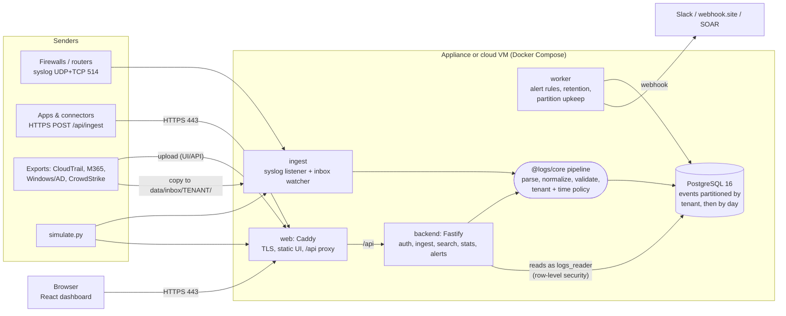
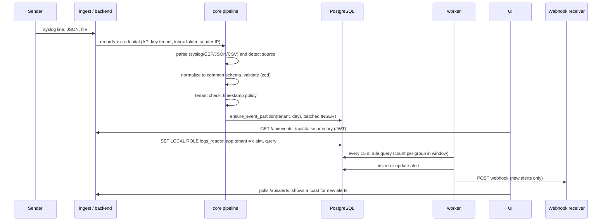

# Architecture

A multi-tenant log management system that collects events from several sources, normalizes
them into one schema, stores them per tenant in PostgreSQL, and offers search, a dashboard
and alerting behind HTTPS. The same containers run as a single-machine appliance or on a
cloud VM (SaaS).

## 1. Components and data flow



| Service | Technology | Responsibility |
|---|---|---|
| `web` | Caddy 2 | Terminates HTTPS (self-signed or Let's Encrypt), serves the built UI, proxies `/api/*`, sets security headers (CSP, X-Frame-Options, HSTS with real certificates). |
| `backend` | Node.js 22, Fastify 5, TypeScript | Login (JWT), RBAC and tenant scoping, `POST /api/ingest` (JSON, NDJSON, text) and file upload, search, dashboard statistics, alert rules and alerts, admin APIs, health and Prometheus metrics. Owns the database schema (runs migrations at start). |
| `ingest` | Node.js | Syslog server on UDP and TCP (RFC 3164, RFC 5424, CEF, key=value; newline and octet-counted framing) and the inbox folder collector. Buffers and batches inserts. |
| `worker` | Node.js | Evaluates alert rules every 15 s and sends webhooks; pre-creates partitions; drops expired partitions (retention). Uses a Postgres advisory lock as leader election so only one instance evaluates rules. |
| `db` | PostgreSQL 16 | Event store and all metadata (tenants, users, keys, rules, alerts, heartbeats). |
| `@logs/core` | TypeScript library | Shared by all services: schema, parsers, normalizers, ingest pipeline, query language, alert evaluation, DB helpers. |
| `frontend` | React 19, Vite, Recharts | Dashboard, search, alerts and rules, sources (send data, upload, keys, pipeline health), admin. |

### The life of an event



Every ingest path (syslog, HTTP JSON, HTTP text, file upload, inbox folder) calls the same
`processRecords()` function, so tenant rules, timestamp handling and validation are
identical whatever the transport.

## 2. Ingestion

| Path | Protocol / format | Tenant comes from | Typical sources |
|---|---|---|---|
| Syslog | UDP and TCP 514; RFC 3164, RFC 5424, CEF, key=value (demo, Fortinet, iptables/UFW) | sender IP via `SYSLOG_TENANT_MAP`, else `SYSLOG_DEFAULT_TENANT` | firewall, network |
| HTTP API | HTTPS `POST /api/ingest`; JSON object, array, `{"events": []}`, CloudTrail `{"Records": []}`, NDJSON, `text/plain` syslog lines | tenant-bound API key, or the record's `tenant` field (global key) | api, crowdstrike, aws, m365, ad, firewall over HTTP |
| File upload | `POST /api/ingest/file` multipart (UI page Sources) | form field, or each record | CloudTrail, M365 audit, Windows/AD CSV or JSON, CrowdStrike |
| Inbox folder | `data/inbox/<tenant>/*` (polled every 5 s) | the sub-folder name | exports dropped by scripts or SFTP |
| Simulator | `samples/simulate.py` over syslog and HTTPS | per record | all seven sources |

Syslog is buffered in memory (flushed every second or every 200 events). If the database is
down, batches go back into the buffer (bounded at 50 000 events) and are retried, so a
database restart does not lose UDP messages that already arrived. HTTP ingest inserts
synchronously, so a `200` response means the events are stored and searchable.

A batch insert that fails because of one bad record is retried row by row: only the bad
record is rejected (reported back to the sender with its index and reason).

## 3. Normalization and the common schema

All sources map to one table; the original record is kept untouched in `raw`.

| Field | Notes |
|---|---|
| `@timestamp` (`ts`) | event time, `timestamptz`; see timestamp policy below |
| `tenant`, `source` | source is one of firewall, network, api, crowdstrike, aws, m365, ad |
| `vendor`, `product` | e.g. amazon / cloudtrail, microsoft / windows-security |
| `event_type`, `event_subtype` | vendor event name (CreateUser, LogonFailed, traffic_deny) and detail |
| `severity` | 0-10 on one scale: syslog severity, CrowdStrike 1-5, CEF 0-10 are all converted |
| `action` | allow, deny, create, delete, login, logout, alert |
| `outcome` | success, failure (added to the suggested schema) |
| `src_ip`, `src_port`, `dst_ip`, `dst_port`, `protocol` | IPs stored as `inet` (CIDR queries) |
| `user` (`username` column), `host`, `process`, `url`, `http_method`, `status_code` | |
| `rule_name`, `rule_id` | firewall policy, CEF signature, detection name |
| `cloud.account_id`, `cloud.region`, `cloud.service` | flattened to columns |
| `_tags` (`tags`) | e.g. `event_id:4625`, `workload:Exchange`, `ts_restamped`, `format:cef` |
| `raw` | the original record (JSONB) |

`outcome` is the one deliberate addition. Without it, "failed login" means a different
field in every source (`event_id=4625`, `Operation=UserLoginFailed`, `ConsoleLogin=Failure`,
`event_type=app_login_failed`). With it, a single rule, `action:login outcome:failure`,
covers all of them.

Each normalizer accepts both the assignment's abridged samples and the vendor's native
format:

| Source | Native formats understood |
|---|---|
| firewall | key=value with field aliases (`src`/`srcip`/`SRC`, `dpt`/`dstport`/`DPT`, ...), Fortinet quoted values and numeric protocols, CEF, UFW/iptables prefixes, or JSON |
| network | router/switch key=value syslog; anything that is not a firewall log (plain text is kept as `syslog`, unparseable lines as `syslog_unparsed`, never dropped) |
| aws | CloudTrail records: `eventName`, `eventSource`, `userIdentity`, `sourceIPAddress` (service names such as `ec2.amazonaws.com` are not treated as IPs), `ConsoleLogin` result, `errorCode` |
| m365 | Unified Audit Log: `Operation`, `UserId`, `ClientIP` (with port or IPv6 brackets), `ResultStatus`, `CreationTime` without zone (UTC) |
| ad | flat Windows exports (`EventID`, `TargetUserName`, `IpAddress`, ...), Winlogbeat `winlog.event_data`, PowerShell `/Date(...)/` timestamps; 19 security event IDs mapped (4624, 4625, 4740, 4720, 1102, ...) |
| crowdstrike | Falcon streaming `DetectionSummaryEvent` (`metadata` + `event`), severity 1-5 scaled to 0-10 |
| api | generic application events (`event_type`, `user`, `ip`, `reason`, ...) with strict validation |

When a record has no `source`, it is detected from its shape (CloudTrail has `eventSource` +
`eventName`, M365 has `Operation` + `Workload`, and so on), or from the file name
(`aws_cloudtrail.json`).

### Timestamp policy

* **Syslog RFC 3164** has no year and no time zone. In the default `auto` mode, those
  messages are stamped with the arrival time; RFC 5424 and ISO timestamps (with a zone) are
  trusted. The device's original timestamp stays in `raw`.
* **Out-of-window events.** Data is only kept for `RETENTION_DAYS`, so an event older than
  that (the assignment's samples are from 2025-08-20) would be deleted by the next retention
  run. With `LATE_EVENT_POLICY=restamp` (the default) it is stored with the arrival time and
  tagged `ts_restamped`, and the original time stays in `raw`. With `reject`, the sender gets
  an error instead. Events more than `MAX_FUTURE_MINUTES` in the future are handled the same
  way.
* Records without any timestamp get the arrival time.

## 4. Storage and query

### Why PostgreSQL

PostgreSQL covers every requirement with one dependency that is easy to run on a small VM
and easy to explain:

* time-range search with partition pruning
* full-text substring search through a trigram index
* JSON queries on the original record (GIN)
* row-level security for tenant isolation
* transactional metadata (users, rules, alerts)

OpenSearch would give better full-text relevance at large scale, but it needs ≥2-4 GB of heap
and its own security plugin for tenant isolation. ClickHouse would give faster aggregations,
but it has no row-level security and is weaker at point lookups. For a demo-sized appliance
(and up to tens of millions of events per day), PostgreSQL is the simpler choice. Section 10
covers what would change at a larger scale.

### Partitioning: true multi-tenancy

```
events                         partitioned by LIST (tenant)
├── events_demoA               partitioned by RANGE (ts)
│   ├── events_demoA_20261011  one table per UTC day
│   └── events_demoA_20261012
└── events_demoB
    └── events_demoB_20261012
```

* Every tenant has its own physical tables and indexes. This is the "true multi-tenancy
  (separate tables)" bonus.
* A query for one tenant and a time range only touches that tenant's matching days.
  Pruning is verified with `EXPLAIN`: other tenants are removed at plan time, older days at
  execution time.
* Partitions are created on demand (`ensure_event_partition()`, serialized with an advisory
  lock). The worker also pre-creates today and the next two days, so inserts never wait on
  DDL at midnight.
* Indexes, defined once on the parent and created on every partition:
  * the primary key `(tenant, ts, id)`, which also serves newest-first sorting
  * `(src_ip, ts)`, `(username, ts)`, `(event_type, ts)` and `(source, ts)`
  * GIN on `tags`
  * GIN `jsonb_path_ops` on `raw`, for `raw.field:value`
  * a trigram GIN on `raw::text`, for free text

### Query language

One small language is used by the search box, the dashboard filters and alert rules. It is
compiled to parameterized SQL (`packages/core/src/query.ts`), so user input never becomes SQL
text.

```
user:alice src_ip:10.0.0.0/8 -source:firewall severity:>=7 host:WIN* event_type:a,b
tag:ts_restamped raw.eventName:CreateUser "DNS blocked"
```

Exact match on keyword fields, `*` wildcards (case-insensitive), CIDR for IP fields, numeric
comparisons, negation, lists, tags, fields of the original record (JSON containment) and free
text (trigram index). Invalid input (an IP like `999.1.1.1`) is a `400` with a clear message.

Search uses keyset pagination (`(ts, id) < cursor`), so later pages stay fast and stable while
new events arrive. The total count is capped at 10 000 so that counting never costs more than
the search itself.

### Retention

`drop_expired_partitions(RETENTION_DAYS)` drops whole daily tables once the day ended more
than `RETENTION_DAYS` ago. That means at least 7 days are always kept (between 7 and 8, since
partitions are daily), and deleting costs a `DROP TABLE` instead of a slow `DELETE`. Tenants
can override the default (`tenants.retention_days`, minimum 7) on the Admin page. The worker
runs retention every 10 minutes; alert history is kept for 90 days.

## 5. Tenant model and security

### Isolation in layers

1. **Credential → tenant.** A user's tenant is in their JWT (`tenant` claim). API keys can be
   bound to a tenant. An inbox sub-folder or a syslog sender mapping pins the tenant too. A
   bound credential that tries to write another tenant's records gets a per-record error.
2. **API scoping.** Every read resolves a scope from the claim
   (`resolveScope(user, ?tenant=)`). Users bound to a tenant who ask for another tenant get
   `403`. Global admins can pick a tenant with `?tenant=` or `X-Tenant`.
3. **PostgreSQL row-level security.** Reads run inside a transaction that does
   `SET LOCAL ROLE logs_reader` and `set_config('app.tenant', <claim>, true)`. Policies on
   `events`, `alerts` and `alert_rules` filter rows in the database itself, so a query that
   forgets `WHERE tenant = ...` still cannot leak another tenant's data. The transaction is
   `READ ONLY`, and `logs_reader` has only `SELECT`. An integration test checks that a query
   without any tenant condition returns only the scoped tenant's rows, and that `DELETE` is
   refused.
4. **Physical separation.** Each tenant's events live in their own tables (above).

### Roles

| Capability | Viewer | Tenant admin | Global admin |
|---|---|---|---|
| Dashboard, search, alerts, rules (read) | own tenant | own tenant | all tenants |
| Upload files, ingest with login | no | own tenant | any tenant |
| Create, edit and delete alert rules; acknowledge alerts | no | own tenant | all, including rules for every tenant |
| Users and API keys | no | own tenant | all |
| Tenants and retention; Prometheus metrics | no | no | yes |

### Other controls

* **Passwords** are hashed with argon2id. Login answers in constant time for unknown users
  (it verifies against a dummy hash) and is rate-limited: 10 failures per IP and username in
  15 minutes return `429`.
* **API keys** are random 192-bit values (`lm_...`). Only their SHA-256 is stored, and the
  plain key is shown once. Keys can be revoked.
* **JWT** tokens are HS256, expire after 8 h, and the secret is at least 32 characters. In
  production, the backend refuses to start with missing or placeholder secrets (`run.sh`
  generates random ones).
* **Input validation**: zod schemas on every request body and query; a parameterized query
  builder; body limits (10 MB JSON, 50 MB uploads, at most 10 000 records per request).
* **TLS**: Caddy serves HTTPS only and redirects HTTP. Appliance mode uses an internal CA,
  so certificates are issued on demand for whatever name or IP the browser uses. SaaS mode
  with a domain uses Let's Encrypt and sends HSTS (HSTS is deliberately off for self-signed
  certificates, so browsers still let you continue past the warning).
* **Headers**: Content-Security-Policy (`script-src 'self'`, no inline scripts),
  `X-Frame-Options: DENY`, `nosniff`, `Referrer-Policy: no-referrer`.
* **Containers**: Node services run as the unprivileged `node` user; syslog binds port 5514
  inside the container and is published as 514. The database port is bound to 127.0.0.1 in
  appliance mode and not published at all in SaaS mode.

## 6. Alerting

A rule is written in the search language plus a threshold:

```
query: action:login outcome:failure   group_by: src_ip   threshold: 5   window: 5 min
```

Every 15 s the worker runs one aggregate query per enabled rule:

```sql
SELECT tenant, host(src_ip) AS group_key, count(*), min(ts), max(ts), (array_agg(...))[1:5]
FROM events WHERE <compiled query> AND ts >= now() - interval '5 min'
GROUP BY 1, 2 HAVING count(*) >= 5
```

* **Deduplication.** A hit that continues an active alert (same rule, tenant and key, seen
  again within one window) updates its count and `last_seen`. Otherwise a new alert is
  created and notified once.
* **Notification.** The UI badge and a toast appear within one poll (10 s). A JSON webhook
  is sent per new alert (rule `webhook_url`, or `ALERT_WEBHOOK_URL`). Its `text` field makes
  it work as-is with Slack/Mattermost incoming webhooks; email can be bridged through n8n or
  Zapier. The worker retries up to 3 times, with 5 s timeouts, and records the delivery
  status on the alert.
* **Defaults** (seeded): brute force (5+ failed logins from one IP in 5 min), CrowdStrike
  detection with severity ≥ 7, and firewall deny burst (20+ denies from one IP in 5 min).
* The **Test rule** button runs the same query as a dry run before a rule is saved.

## 7. Observability

* Every service writes a heartbeat with counters to `service_heartbeats` every 10 s.
  Counters include syslog UDP/TCP messages, accepted and rejected events, buffered events,
  files processed, rule evaluations, alerts created and webhooks sent. The UI shows them on
  **Sources → Pipeline health**.
* `GET /api/metrics` exposes Prometheus metrics: HTTP requests by route and status, ingest
  counts, logins, open alerts per tenant, partitions per tenant, and service liveness and
  counters. It needs a global admin token or `Authorization: Bearer $METRICS_TOKEN`.
* Structured JSON logs (pino) from the backend; Docker log rotation (10 MB × 3).

## 8. Deployment modes

| | Appliance | SaaS / cloud |
|---|---|---|
| Command | `./run.sh up` | `./run.sh saas` |
| Compose files | `docker-compose.yml` | plus `docker-compose.saas.yml` |
| TLS | self-signed (internal CA, any host or IP) | Let's Encrypt for `DOMAIN` (or self-signed on the IP) |
| Database port | 127.0.0.1:5433 (for psql and development) | not published |
| Reached at | `https://<appliance IP>`, syslog `<IP>:514` | `https://<domain>`, syslog `<domain>:514` |

Both modes use the same images: the `app` target for backend, ingest and worker, and the
`web` target for Caddy with the built UI (one multi-stage `Dockerfile`).

## 9. Technology choices

| Choice | Why |
|---|---|
| TypeScript everywhere | One language for the parsers, API and UI. The shared `@logs/core` package means the UI, API and worker can never disagree about the schema or the query language. |
| Fastify | Fast JSON handling and built-in plugins for JWT, multipart and CORS; `inject()` makes API tests run without a network. |
| zod | One definition for validation and TypeScript types of the common schema and request bodies. |
| PostgreSQL 16 | See section 4. |
| Caddy | Automatic HTTPS (internal CA or Let's Encrypt) with a 40-line config; no certbot cron. |
| React + Recharts | Component model for a dashboard with drill-downs; Recharts covers the stacked timeline with accessible tooltips. |
| Docker Compose | Exactly what the appliance needs (one host, restart policies, health-ordered startup) and the same artifact runs on any cloud VM. |

## 10. Limits and next steps

* **Scale.** One Postgres instance comfortably handles millions of events per day on the
  appliance size (4 vCPU / 8 GB). Beyond that, the next steps are:
  * a durable queue between ingest and storage (Kafka, NATS JetStream or Redpanda), so
    ingestion survives longer database outages
  * horizontal ingest instances (the services are stateless; the worker already has leader
    election)
  * moving events to ClickHouse or OpenSearch while keeping Postgres for metadata
* **Syslog over TLS** (RFC 5425, port 6514) and mutual TLS for API senders.
* **SSO** (OIDC) instead of local users; field-level RBAC (for example, hiding `raw` from some
  viewers).
* **Enrichment** (GeoIP, reverse DNS) in the pipeline: there is one place to add it,
  `processRecords()`.
